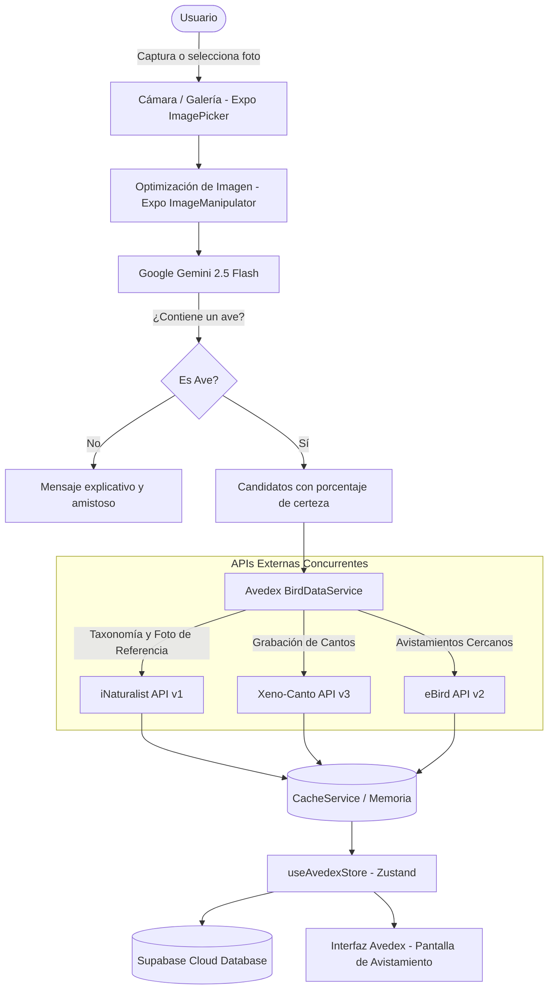

# 🦅 Avedex — Tu Pokédex de Avifauna con Inteligencia Artificial

[](https://expo.dev)
[](https://reactnative.dev)
[](https://www.typescriptlang.org)
[](https://www.nativewind.dev)
[](https://supabase.com)
[](https://ai.google.dev)
[](https://avedex-eight.vercel.app)
[](Avedex/LICENSE)

> ### 🌐 Versión Web en Vivo
> Explora y prueba la aplicación web desplegada en producción directamente desde cualquier navegador:
> 🔗 **[https://avedex-eight.vercel.app](https://avedex-eight.vercel.app)**

---

## 📌 1. Título y Descripción

**Avedex** es una aplicación móvil universal inspirada en el concepto de la *Pokédex*, orientada a revolucionar la experiencia de la observación de aves (*birdwatching*) y la ornitología de campo mediante visión artificial, enriquecimiento bioacústico y ciencia comunitaria. 

Diseñada para observadores principiantes, naturalistas y ornitólogos experimentados, Avedex permite capturar o subir imágenes de aves en su hábitat natural, identificarlas al instante mediante modelos multimodales avanzados de **Google Gemini AI**, y desbloquear fichas taxonómicas interactivas alimentadas en tiempo real por las bases de datos de biodiversidad más respetadas del planeta: **iNaturalist**, **eBird** y **Xeno-Canto**.

---

## 🎯 2. Funcionalidad y Propósito

### ¿Qué necesidad resuelve?
La ornitología tradicional suele presentar una curva de aprendizaje pronunciada: la consulta en guías de campo impresas puede ser lenta, la discriminación de especies crípticas requiere entrenamiento taxonómico riguroso y la validación de cantos exige un extenso archivo bioacústico disperso en diversas fuentes.

**Avedex unifica y simplifica este proceso:**
- **Identificación Inmediata en Campo:** Reconoce aves a partir de una única fotografía, discriminando falsos positivos (objetos, paisajes u otros animales) y contextualizando el resultado según la ubicación geográfica del usuario.
- **Gamificación del Aprendizaje:** Convierte el avistamiento en una experiencia inmersiva de colección, incentivando el contacto con la naturaleza mediante porcentajes de progreso del catálogo, niveles de rareza (*Common*, *Uncommon*, *Rare*, *Legendary*) y registro de hitos personales.
- **Ciencia Colaborativa y Conservación:** Promueve la participación ciudadana facilitando la organización de excursiones grupales y permitiendo la exportación de registros bajo estándares científicos compatibles con plataformas internacionales.

---

## ✨ 3. Características Principales

- 🔍 **Identificación Asistida por IA:** Clasificación visual precisa utilizando el modelo de última generación `gemini-2.5-flash` a través de [`Avedex/services/geminiService.ts`](Avedex/services/geminiService.ts:23), proporcionando múltiples candidatos ordenados por índice de confianza, justificación morfológica y alertas amigables cuando no se detecta ningún ave.
- 📖 **Catálogo "Avedex" Dinámico:** Registro personal de avistamientos con fotos del usuario, fotografías de referencia en alta resolución, descripciones ecológicas, estado de conservación y rango altitudinal.
- 🗺️ **Mapa Interactivo con Agrupamiento (Clustering):** Explorador cartográfico potenciado por [`react-native-maps`](Avedex/package.json:40) y [`react-native-map-clustering`](Avedex/package.json:39), visualizando avistamientos georreferenciados con coordenadas GPS exactas.
- 🔊 **Reproductor Bioacústico Integrado:** Escucha y comparación directa de cantos y llamados territoriales obtenidos desde la base de grabaciones de **Xeno-Canto**, utilizando [`expo-audio`](Avedex/package.json:11).
- 👥 **Comunidad y Excursiones:** Espacio social para descubrir, unirse o programar expediciones de avistamiento con cupos limitados, destinos específicos y especies objetivo.
- ☁️ **Sincronización en la Nube y Modo Offline:** Almacenamiento local resiliente con [`AsyncStorage`](Avedex/package.json:8) mediante persistencia reactiva en Zustand, sincronizado con base de datos relacional y autenticación en **Supabase**.
- 🔒 **Seguridad y Acceso Biométrico:** Inicio de sesión protegido con biometría (huella dactilar / reconocimiento facial) mediante [`expo-local-authentication`](Avedex/package.json:21).
- 📤 **Exportación de Datos:** Generación de planillas compatibles con el formato estándar de **eBird** en formato CSV y respaldos completos de la colección en JSON mediante [`Avedex/services/exportService.ts`](Avedex/services/exportService.ts:6).
- 🌐 **Soporte Bilingüe:** Internacionalización nativa (Español e Inglés) administrada por [`i18next`](Avedex/package.json:31).

---

## 🛠️ 4. Tecnologías Utilizadas

| Categoría | Tecnología / Herramienta | Descripción / Propósito |
| :--- | :--- | :--- |
| **Framework Base** | [React Native 0.86](https://reactnative.dev) / [Expo SDK 57](https://expo.dev) | Desarrollo de la aplicación móvil universal (iOS, Android, Web). |
| **Enrutamiento** | [Expo Router ~57.0](https://docs.expo.dev/router/introduction/) | Navegación basada en el sistema de archivos con layouts anidados. |
| **Lenguaje** | [TypeScript 6](https://www.typescriptlang.org) | Tipado estático estricto y mantenibilidad de la base de código. |
| **Estilos & UI** | [NativeWind v4](https://www.nativewind.dev) / [Tailwind CSS 3](https://tailwindcss.com) | Sistema de diseño declarativo con utilidades CSS responsivas. |
| **Iconografía** | [Lucide React Native](https://lucide.dev) | Colección de íconos vectoriales modernos y ligeros. |
| **Estado Global** | [Zustand v5](https://zustand.docs.pmnd.rs) | Gestión de estado global con middleware de persistencia local. |
| **Backend & Base de Datos** | [Supabase Client 2.112](https://supabase.com) | Autenticación de usuarios, base de datos PostgreSQL y sincronización. |
| **Inteligencia Artificial** | [Google Generative AI SDK](https://ai.google.dev) (`@google/generative-ai`) | Análisis y visión artificial multimodal con `gemini-2.5-flash`. |
| **API Taxonómica** | [iNaturalist API v1](https://api.inaturalist.org/v1) | Búsqueda de taxones, nombres vulgares, taxonomía y fotos oficiales. |
| **API Ornitológica** | [eBird API v2](https://documenter.getpostman.com/view/664302/S1ENwy59) | Estadísticas de avistamientos recientes y puntos críticos de observación. |
| **API Bioacústica** | [Xeno-Canto API v3](https://xeno-canto.org/explore/api) | Repositorio internacional de grabaciones de vocalizaciones de aves. |
| **Hardware & Sensores** | Expo Location, Expo Image Picker, Expo Audio | Acceso a GPS, cámara, galería y subsistema de audio nativo. |

---

## ⚙️ 5. Cómo Funciona

Avedex orquesta un flujo de datos desacoplado y reactivo, fusionando inteligencia artificial y servicios externos mediante servicios unificados.



### Flujo de Ejecución Detallado:
1. **Captura y Geolocalización:** Al fotografiar un ave en [`Avedex/app/(tabs)/capture.tsx`](Avedex/app/(tabs)/capture.tsx), la aplicación obtiene simultáneamente las coordenadas satelitales del dispositivo vía [`expo-location`](Avedex/package.json:22).
2. **Procesamiento de Imagen:** La fotografía se reescala y convierte a base64 mediante [`expo-image-manipulator`](Avedex/package.json:18) para minimizar el consumo de ancho de banda.
3. **Inferencia con Gemini AI:** En [`Avedex/services/geminiService.ts:identifyBirdWithGemini()`](Avedex/services/geminiService.ts:23), se envía la imagen junto con el contexto geográfico a `gemini-2.5-flash`. El modelo evalúa si la captura contiene un ave; de ser así, genera un arreglo estructurado en JSON con los taxones más probables y su justificación visual.
4. **Agregación Unificada de Datos (`UnifiedBirdData`):** En [`Avedex/services/birdDataService.ts:getUnifiedBirdData()`](Avedex/services/birdDataService.ts:20), la especie identificada es consultada en paralelo mediante [`Promise.allSettled()`](Avedex/services/birdDataService.ts:32) contra:
   - **iNaturalist:** Para extraer el nombre científico, nombre común regional y fotografía de espécimen de referencia.
   - **Xeno-Canto:** Para recuperar el archivo de audio MP3 del canto característico.
   - **eBird:** Para calcular la frecuencia y registros recientes en la región geográfica del observador.
5. **Persistencia y Desbloqueo:** El nuevo avistamiento se guarda en el almacén global [`Avedex/hooks/useAvedexStore.ts`](Avedex/hooks/useAvedexStore.ts:31), sincronizándolo con la base de datos PostgreSQL en [`Avedex/lib/supabase.ts`](Avedex/lib/supabase.ts:13) y desbloqueando la especie en la colección personal del usuario.

---

## 📂 6. Estructura del Proyecto

```text
Avedex/
├── app/                          # Enrutamiento basado en archivos (Expo Router)
│   ├── (auth)/                   # Vistas de autenticación (login, registro)
│   ├── (tabs)/                   # Navegación principal por pestañas
│   │   ├── index.tsx             # Pantalla de inicio y catálogo "Avedex"
│   │   ├── capture.tsx           # Captura, subida e identificación de aves
│   │   ├── map.tsx               # Mapa georreferenciado de avistamientos
│   │   ├── community.tsx         # Gestión y exploración de excursiones grupales
│   │   └── profile.tsx           # Perfil, estadísticas, backups y ajustes
│   ├── _layout.tsx               # Layout raíz de la aplicación y proveedores de contexto
│   └── settings.tsx              # Configuración de cuenta e idioma
├── assets/                       # Recursos estáticos (logos, badges, íconos de pestañas)
├── components/                   # Componentes visuales modulares y reutilizables
│   ├── BirdCard.tsx              # Tarjeta de presentación de especie en la colección
│   └── BirdImage.tsx             # Visor optimizado de fotos de aves
├── config/                       # Archivos de configuración
│   ├── api.ts                    # Endpoints y variables de entorno para APIs
│   └── i18n.ts                   # Configuración del motor de traducción (i18next)
├── constants/                    # Datos estáticos, temas y mocks de respaldo
├── context/                      # Contextos de React (AuthContext)
├── hooks/                        # Hooks personalizados y store reactivo
│   └── useAvedexStore.ts         # Tienda Zustand principal (avistamientos, excursiones)
├── lib/                          # Clientes de servicios externos
│   └── supabase.ts               # Inicialización y cliente de conexión con Supabase
├── services/                     # Lógica de negocio y comunicación con APIs externas
│   ├── api/                      # Clientes HTTP específicos (eBird, iNaturalist, Xeno-Canto)
│   ├── aiIdentifier.ts           # Servicio auxiliar de identificación
│   ├── birdDataService.ts        # Pipeline unificador de datos biológicos y caché
│   ├── cacheService.ts           # Sistema de almacenamiento en caché para respuestas de API
│   ├── exportService.ts          # Generador de exportaciones a formato eBird CSV y JSON
│   ├── geminiService.ts          # Integración directa con Google Generative AI
│   └── notificationService.ts    # Despacho y manejo de notificaciones locales
├── types/                        # Definiciones de tipos e interfaces TypeScript
└── utils/                        # Funciones utilitarias (biometría, navegación)
```

---

## 🚀 7. Instalación y Uso

### Prerrequisitos
- [Node.js](https://nodejs.org/) (versión 18.x o superior recomendada).
- [npm](https://www.npmjs.com/), [yarn](https://yarnpkg.com/) o [pnpm](https://pnpm.io/).
- Dispositivo móvil con la aplicación [Expo Go](https://expo.dev/go) instalada (iOS o Android) o un emulador de desarrollo configurado ([Android Studio](https://developer.android.com/studio) / [Xcode](https://developer.apple.com/xcode/)).

### 1. Clonar el repositorio y acceder al directorio
```bash
git clone <url-del-repositorio>
cd Avedex
```

### 2. Instalar dependencias
```bash
npm install
```

### 3. Configurar variables de entorno
Crea un archivo `.env` en la raíz de la carpeta `Avedex/` tomando como referencia el archivo [`Avedex/.env.example`](Avedex/.env.example):

```bash
cp .env.example .env
```

Edita el archivo `.env` e ingresa tus credenciales y llaves de acceso a las APIs:
```env
# Google Gemini AI (Requerido para identificación inteligente)
EXPO_PUBLIC_GEMINI_API_KEY=tu_clave_de_google_gemini

# iNaturalist API
EXPO_PUBLIC_INATURALIST_BASE_URL=https://api.inaturalist.org/v1

# eBird API (The Cornell Lab of Ornithology)
EXPO_PUBLIC_EBIRD_BASE_URL=https://api.ebird.org/v2
EXPO_PUBLIC_EBIRD_API_KEY=tu_clave_de_ebird

# Xeno-Canto API
EXPO_PUBLIC_XENO_CANTO_BASE_URL=https://xeno-canto.org/api/3/recordings
EXPO_PUBLIC_XENO_CANTO_API_KEY=tu_clave_de_xeno_canto

# Supabase (Autenticación y Persistencia)
EXPO_PUBLIC_SUPABASE_URL=https://tu-proyecto.supabase.co
EXPO_PUBLIC_SUPABASE_ANON_KEY=tu_anon_key_de_supabase
```

### 4. Iniciar el servidor de desarrollo
```bash
npx expo start
```

### 5. Comandos de ejecución rápida
- **Android:** `npm run android`
- **iOS:** `npm run ios`
- **Navegador Web:** `npm run web`
- **Verificación de sintaxis y tipado:** `npm run lint`

---

## 📱 8. Generación e Instalación de APK para Android

Si deseas compilar, instalar y probar Avedex en un dispositivo Android de forma independiente (sin depender de Expo Go), dispones de dos alternativas para generar el archivo APK:

### ⚙️ Opción 1: Compilación local con Gradle / React Native CLI

Esta opción requiere contar con el entorno local de desarrollo Android configurado ([Android Studio](https://developer.android.com/studio), Android SDK, variable `ANDROID_HOME` y JDK).

1. **Precompilar el proyecto nativo (si aún no se ha generado la carpeta `android/`):**
   ```bash
   npx expo prebuild --platform android
   ```

2. **Compilar el archivo APK Release usando Gradle:**
   ```bash
   cd android
   ./gradlew assembleRelease
   ```
   *(Para una versión de depuración rápida puedes usar: `./gradlew assembleDebug`)*

   Alternativamente, puedes compilarlo directamente a través de Expo CLI:
   ```bash
   npx expo run:android --variant release
   ```

3. **Ubicación del archivo APK resultante:**
   - **APK Release:** `android/app/build/outputs/apk/release/app-release.apk`
   - **APK Debug:** `android/app/build/outputs/apk/debug/app-debug.apk`

---

### ☁️ Opción 2: Compilación en la nube con EAS Build (Recomendada)

Con **EAS Build (Expo Application Services)** puedes compilar el APK directamente en la infraestructura en la nube de Expo sin necesidad de instalar Android Studio ni configurar SDKs locales:

1. **Instalar EAS CLI globalmente:**
   ```bash
   npm install -g eas-cli
   ```

2. **Iniciar sesión en tu cuenta de Expo:**
   ```bash
   eas login
   ```

3. **Configurar el perfil de compilación de APK en `eas.json`:**
   Asegúrate de contar con un perfil configurado con `"buildType": "apk"` (por ejemplo en el perfil `preview`):
   ```json
   {
     "build": {
       "preview": {
         "android": {
           "buildType": "apk"
         }
       }
     }
   }
   ```

4. **Ejecutar la compilación en la nube:**
   ```bash
   eas build -p android --profile preview
   ```
   Al finalizar el proceso, la consola te proporcionará un enlace directo de descarga y un código QR para bajar el archivo `.apk` listo para instalar, sin requerir publicación en Google Play Store.

---

### 📲 Instrucciones de Instalación en el Dispositivo Android

Una vez que tengas el archivo `.apk` (ya sea por compilación local o descarga desde EAS Build):

1. **Habilitar la instalación de apps de orígenes desconocidos:**
   - En tu teléfono Android, ve a **Ajustes / Configuración** > **Seguridad y Privacidad** (o **Aplicaciones y Notificaciones**).
   - Accede a **Instalar aplicaciones desconocidas** o **Fuentes desconocidas**.
   - Habilita el permiso para la aplicación que utilizarás para gestionar o abrir el archivo (por ejemplo, Google Chrome, el Administrador de Archivos / *Files*, o Google Drive).

2. **Transferir el archivo `.apk` al dispositivo:**
   - **Descarga directa:** Si usaste EAS, abre el enlace o escanea el QR desde el navegador del dispositivo para descargarlo directamente.
   - **Vía cable USB:** Conecta el dispositivo a tu PC y copia el archivo `app-release.apk` a la carpeta `Download` o almacenamiento interno.
   - **Nube o mensajería:** Envíalo mediante Google Drive, Telegram o correo electrónico a tu dispositivo.

3. **Instalar la aplicación:**
   - Abre la aplicación de **Archivos** o gestor de descargas en el teléfono.
   - Localiza y presiona sobre el archivo `.apk`.
   - Confirma la instalación tocando en **Instalar**.
   - *(Opcional)* Si Google Play Protect muestra una advertencia de aplicación externa o no verificada, presiona en **Más detalles** y luego en **Instalar de todas formas**.
   - ¡Listo! Abre **Avedex** y comienza a explorar e identificar avifauna.

---

## 📄 9. Licencia

Este proyecto está distribuido bajo la licencia **MIT**. Para más detalles, consulta el archivo [`Avedex/LICENSE`](Avedex/LICENSE).
